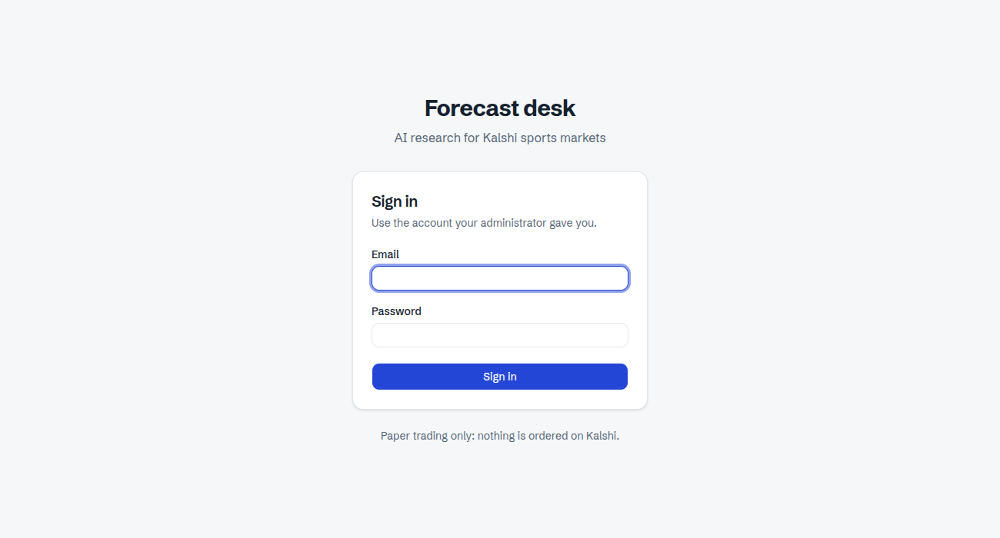
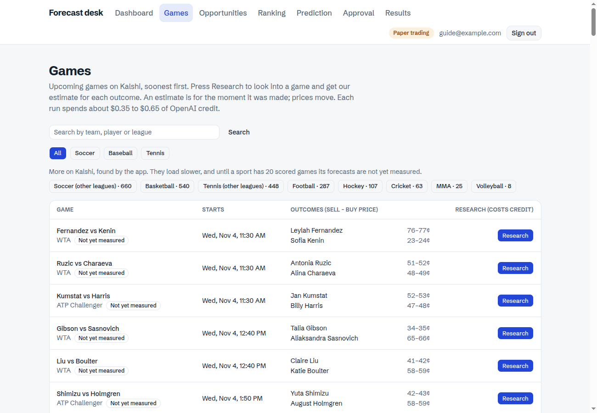
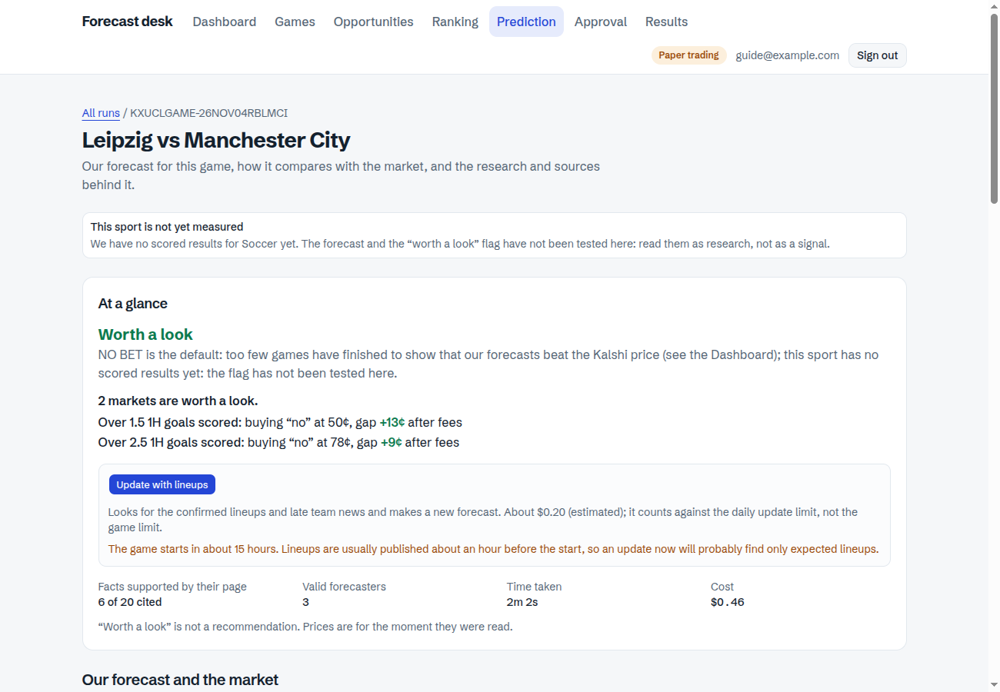
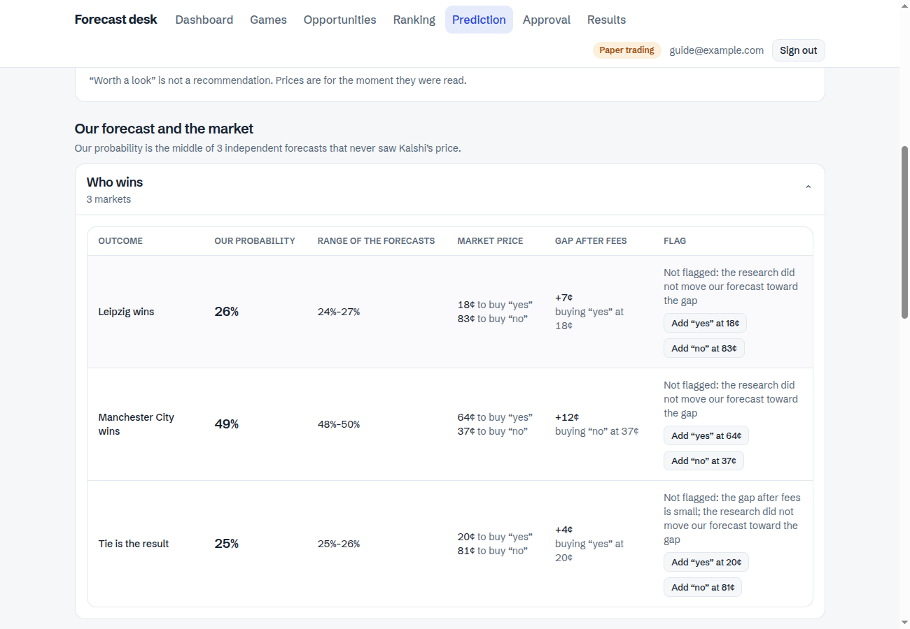
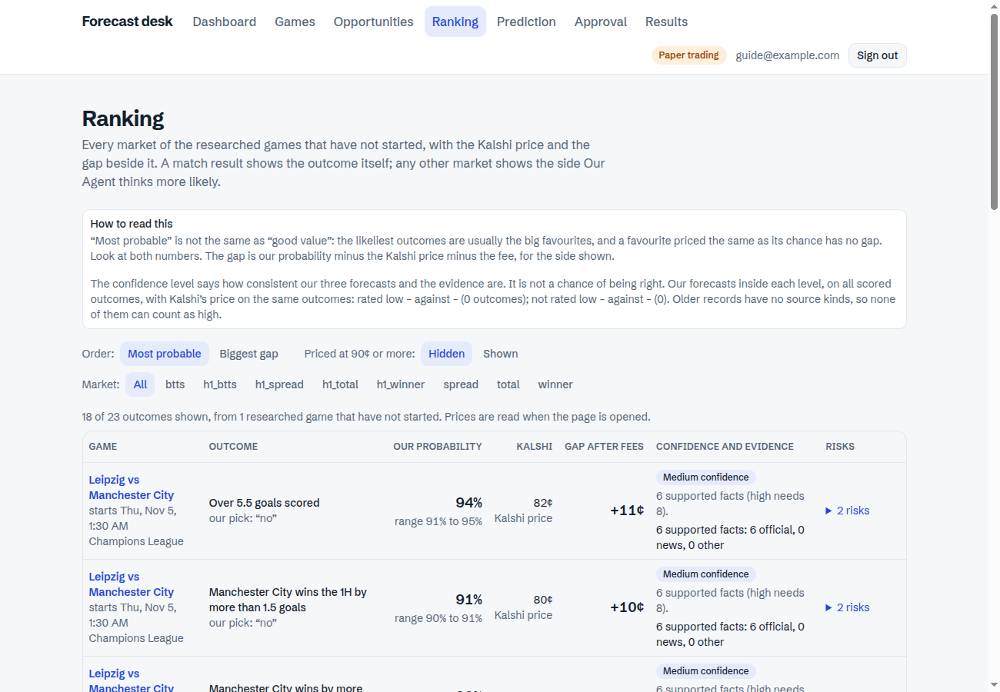
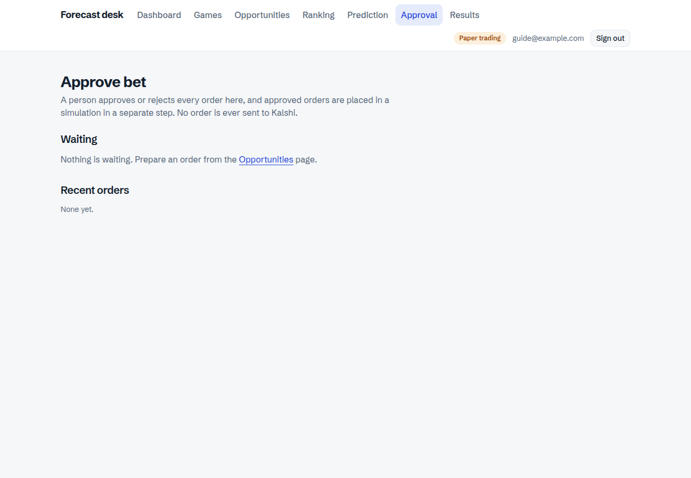
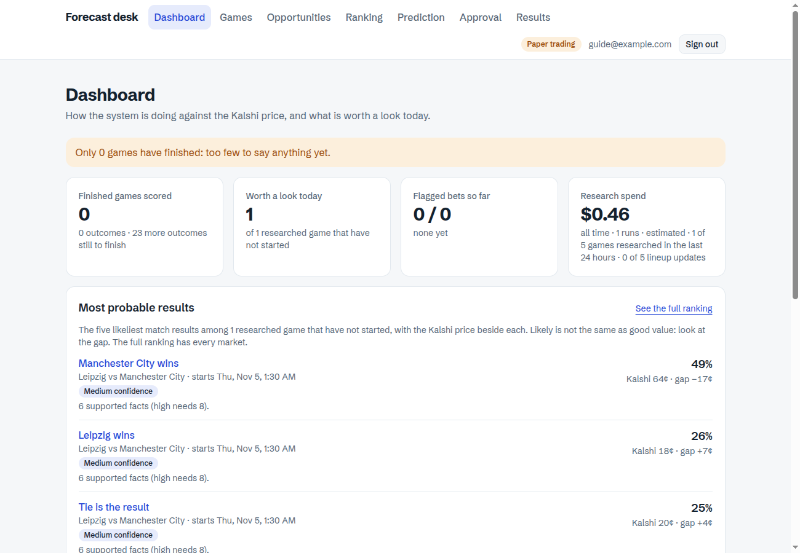

# Our Agent: user guide

This guide is for the person who runs Our Agent on their own computer. It tells you what it is, how to start it, how to use it, and how to read what it shows. It was written on 4 November 2026 and the set-up steps were tested on a fresh copy of the `master` branch on that day.

If anything in this guide does not work or is not clear, tell me what you typed and what you saw. We can also go through it on a call.

---

## 1. What Our Agent is, and what it is not

Our Agent looks into a sports game on Kalshi. It searches the web, reads the pages it finds, checks every fact against its page, and then three separate forecasters each give a probability for every outcome. It shows the middle of the three next to the Kalshi price, and the gap between them after fees.

- **Nothing real is ever ordered.** Our Agent only reads Kalshi. The Approval screen places **simulated** orders only. There is no trading code in it at all.
- **A person approves every simulated order.** Nothing happens by itself.
- **It is a research tool, not a tip service.** "Worth a look" on a screen is not a recommendation.

### The honest status

So far the forecasts are **not better than the Kalshi price**. On 4 November, over **86 finished games** (768 outcomes that have all three numbers), the Brier score (lower is better) was:

| | Brier score |
|---|---|
| Our forecast | 0.1901 |
| The same AI with no research | 0.1913 |
| The Kalshi price | 0.1725 |

The 46 bets that Our Agent flagged as "worth a look" won 17 and, bought at the asking price, lost on average 13 cents per contract (about 6 dollars in total on one contract each). The research made almost no difference (0.1901 with it, 0.1913 without), so there is **no sign of an edge yet**. A first-half forecast and a lineup update have only a handful of games behind them, far too few to say anything. Please read every number in this guide with that in mind.

**Your copy starts empty.** These 86 games are in my database, not in yours. Your Dashboard starts at zero and fills as the games you research finish.

---

## 2. What you need

- **Docker with Docker Compose.** On Windows or Mac, install Docker Desktop. Everything runs inside Docker. I tested on Linux; on Windows or Mac run the same commands in a terminal, and tell me if one fails.
- **An OpenAI API key with credit.** Research needs it. A research run costs about **0.35 to 0.65 US dollars** (0.46 on the test run for this guide). A lineup update costs about 0.20. Without a key the app starts and the Games page works, but pressing Research is refused.
- **A VPN, only if Kalshi is not reachable from where you are.** I could not check from your location. To test, open `https://external-api.kalshi.com/trade-api/v2/exchange/status` in a browser. If you see a short answer with `"exchange_active"`, you do not need a VPN. If it times out, you do.
- **Optional:** an Odds API key (a free bookmaker check on the Games page), and a Telegram bot (alerts). You can skip both.
- **Not needed:** a Kalshi account or key. Our Agent reads Kalshi's public data.

---

## 3. Get the code

Use the clone link that GitHub shows on your repository (the green Code button) and add `-b master`:

```
git clone -b master <the clone link of your repository>
cd KALSHI_PROJECT_REPO
```

`master` is the current version. If your repository still shows the older branch by default, a plain `git clone` would give you the old code, so keep `-b master`. (Setting `master` as the default branch in the repository settings fixes this for good.)

---

## 4. Set it up (about 10 minutes, the first build takes a few minutes more)

**Step 1. Copy the example settings.**

```
cp .env.example .env
```

(On Windows PowerShell: `copy .env.example .env`.)

**Step 2. Open `.env` in a text editor and set these values.** Never share this file, never paste it into a chat, and never commit it.

| Setting | What to put |
|---|---|
| `POSTGRES_PASSWORD` | Any password you choose (replace `change-me`). |
| `DB_HOST_PORT` | Leave `5432`, unless something else on your computer already uses it. If Docker says `port is already allocated`, change it to another number such as `55433`. |
| `SESSION_SECRET` | At least 32 random characters, for example the output of `openssl rand -hex 32`, or just a long random string you type. |
| `SESSION_COOKIE_SECURE` | Change `true` to `false`. This is only for running on your own computer over plain http. |
| `OPENAI_API_KEY` | Your OpenAI key. |

Leave everything else. Each line in `.env.example` has a comment, and every other setting has a safe default.

**Step 3. Start everything.**

```
docker compose up -d --build
docker compose ps
curl http://127.0.0.1:8000/health
```

The first build takes a few minutes. When it is done, `docker compose ps` shows `db`, `backend` and `frontend` as "Up", and the health check answers `{"status":"ok","db":true}`.

If the backend does not start, run `docker compose logs backend`. It says which setting is wrong.

**Step 4. Make your account.** There is no sign-up page. The command asks for a password twice:

```
docker compose exec backend uv run --no-sync python -m app.cli create-user you@example.com
```

**Step 5. Open the app.** Go to `http://127.0.0.1:3000` and sign in.



**To stop:** `docker compose down`. Your data stays. Never use `docker compose down -v` unless you want to delete the whole database.

---

## 5. A first walk through the app (about 30 minutes and about 1 dollar)

The top bar has seven pages: **Dashboard, Games, Opportunities, Ranking, Prediction, Approval, Results**.

### 5.1 Games: find a game

Open **Games**. It lists upcoming Kalshi games, soonest first, with the two sides' prices. Use the search box (try a team name) or the sport buttons. A sport marked "Not yet measured" has fewer than 20 finished games with our forecasts.



### 5.2 Research one game

Press **Research** on a game that starts within the next day. It takes about 4 minutes and costs about 0.35 to 0.65 dollars. You are taken to the result page of that run while it works. Two limits protect your credit: by default **5 games and 5 lineup updates in any 24 hours** (settings `RESEARCH_MAX_PER_DAY` and `RESEARCH_UPDATES_MAX_PER_DAY`).

For soccer games in leagues where Kalshi lists them, Our Agent also forecasts the other markets of the game: total goals, both teams to score, margin of victory, and the **first half** (who is ahead at half time, first-half goals, both teams to score in the first half, first-half margin). A Champions League game gives about 23 forecasts in one run.

### 5.3 Read the result page



From top to bottom:

- **At a glance.** A verdict: **NO BET**, or **Worth a look** with a caution. Then the cost, the time, and how many facts were backed by their page. The **Update with lineups** button looks for confirmed lineups and late team news and makes a new forecast. It costs about 0.20 dollars. Confirmed lineups are usually published about an hour before the start, so an update made much earlier will usually find only expected lineups.
- **Our forecast and the market.** One table per kind of market.



  - **Our probability** is the middle of three independent forecasts. **Range of the forecasts** is how far apart the three were.
  - **Market price** is what it costs to buy "yes" or "no" on Kalshi right now.
  - **Gap after fees** is our probability minus the price minus Kalshi's fee, for the side shown.
  - **Flag** says whether the market passes the tests to be called "worth a look", or why not.
- **The forecasts.** Each forecaster's numbers and reasoning, and the plain AI call with no research.
- **The evidence.** Every fact the research found, with its check against the page, and a label for the kind of website that supports it: **official** (the league, the club, the tournament), **news** (an independent news outlet), or **other**.
- **Pages we tried to read** and **What was researched** show what could not be read and what was looked up.

### 5.4 Ranking: all markets side by side



**Ranking** lists every market of every researched game that has not started, with our probability and the Kalshi price beside it. You can sort by "Most probable" or "Biggest gap". Outcomes priced at 90 cents or more are hidden by default, because the near-certain markets fill the top of the list and have no gap. A match result shows the outcome itself; any other market shows the side Our Agent thinks more likely. The **confidence** label (low, medium, high) says how much confirmed evidence there is and how closely the three forecasts agree. It is not a chance of being right: so far it separates accuracy only weakly. The market filter buttons show internal names (such as `h1_winner` for "first half winner"); I know about this and have logged it to fix.

### 5.5 Opportunities, Approval, Results

- **Opportunities** ranks the researched games by the gap at today's prices, with the verdict on each and the recent **alerts**. Alerts appear here whether or not Telegram is set up.
- **Approval.** On a result page or an Opportunities row, press **Add "yes"** or **Add "no"** on a market, then **Prepare order**. The order waits on the Approval page with its checks (not expired, game not started, forecast recent, within the limits). You press **Approve** or **Reject**, and an approved order is **placed in the simulation**. Nothing is sent to Kalshi. The limits are placeholders; proposed values are in `docs/RISK-FRAMEWORK.md` and I would like your decision on them.
- **Results** shows the simulated orders and what they would have paid, by sport and by kind of market.



### 5.6 Dashboard: how it is doing



The **Dashboard** compares Our Agent's forecasts with the Kalshi price on finished games, and shows what is worth a look today and what the research has cost. On a new copy it says "0 games have finished". **Finished games are filled in by a command, not automatically.** About 3 hours after a researched game starts, run:

```
docker compose exec backend uv run --no-sync python -m app.cli resolve-records
docker compose exec backend uv run --no-sync python -m app.cli score-records
```

The first fills in who won (it only reads Kalshi). The second prints the scores shown in section 1, per kind of market, per sport and per league.

---

## 6. How to read the numbers

- **Brier score** measures how close the probabilities were to what happened. Lower is better. Always saying 50 percent scores 0.25. The three numbers are always on the same outcomes, so they can be compared.
- **Gap after fees** is not a profit. It only says that our forecast differs from the price. A bigger gap is more often a mistake in our forecast than an opportunity, and the app marks a very large gap as "more likely a model error".
- **Worth a look** means the gap is big enough, enough facts were confirmed, enough contracts are offered, and the research moved the forecast toward the gap. It is not a recommendation. So far the flagged bets have lost money on average.
- **Too few games** appears where a group is small. Under about 50 games, a score tells you very little. Take that message literally.
- **The markets of one game move together**, so the number of games matters more than the number of outcomes.

---

## 7. What costs money, and what is switched off

| What | Cost | Notes |
|---|---|---|
| Research on one game | about 0.35 to 0.65 USD | Limited to 5 games per 24 hours by default. |
| Lineup update | about 0.20 USD | Limited to 5 per 24 hours by default. |
| Free bookmaker check on the Games page | 0 OpenAI credit | Uses Odds API credits, only if you set an Odds API key. |

These are **off** until you switch them on in `.env`: the watcher (`MONITOR_ENABLED`), Telegram alerts (`ALERTS_ENABLED`), automatic research (`AUTO_RESEARCH_MAX_PER_DAY`), automatic lineup updates (`AUTO_UPDATE_MAX_PER_DAY`). The last two spend money without anyone pressing a button, so switch them on deliberately. After changing `.env`, run `docker compose up -d` again. The costs shown in the app are estimates calculated from the tokens used, not your OpenAI bill.

---

## 8. If something goes wrong

| What you see | What to do |
|---|---|
| `port is already allocated` when starting | Change `DB_HOST_PORT` in `.env` to a free number, run `docker compose up -d` again. |
| `docker compose ps` shows the backend not running | Run `docker compose logs backend`. The first error line says which setting is wrong. |
| The Games page is empty or says Kalshi could not be reached | Check the Kalshi link in section 2. You may need a VPN. |
| Pressing Research is refused | `OPENAI_API_KEY` is missing in `.env`, or the account has no credit. |
| A message about the daily limit | The 24-hour limit is on purpose. It counts the last 24 hours. |
| The browser says `too many redirects` on the sign-in page | The browser still holds an old session from before the database was reset or a password was changed. Delete the cookies for `127.0.0.1` (or open a private window) and sign in again. I have logged this as a bug to fix. |
| You are locked out | Five wrong passwords lock an account for 15 minutes. `docker compose exec backend uv run --no-sync python -m app.cli set-password you@example.com` sets a new one. |
| Everything is gone | You probably ran `docker compose down -v`, which deletes the database. |

More detail: `docs/RUNBOOK.md` (day to day), `docs/HOW-IT-WORKS.md` (what each step does and why), `docs/RISK-FRAMEWORK.md` (limits and stop rules).

---

## 9. What Our Agent cannot do

- **It has not shown an edge.** The scores in section 1 are the evidence, and they say the Kalshi price is better than our forecast.
- **The samples are small.** 86 finished games, and far fewer for first-half markets, lineup updates and any single league.
- **It does not see news that has not been written yet**, and the watcher cannot see news at all: it sees prices, new forecasts and the clock.
- **A page that lies can pass the check.** The judge confirms that a page says something, not that it is true. In the injection experiment, false information was the weak point, not hostile instructions.
- **Only simulated orders.** A real order would be a separate, much larger step with limits you decide.
